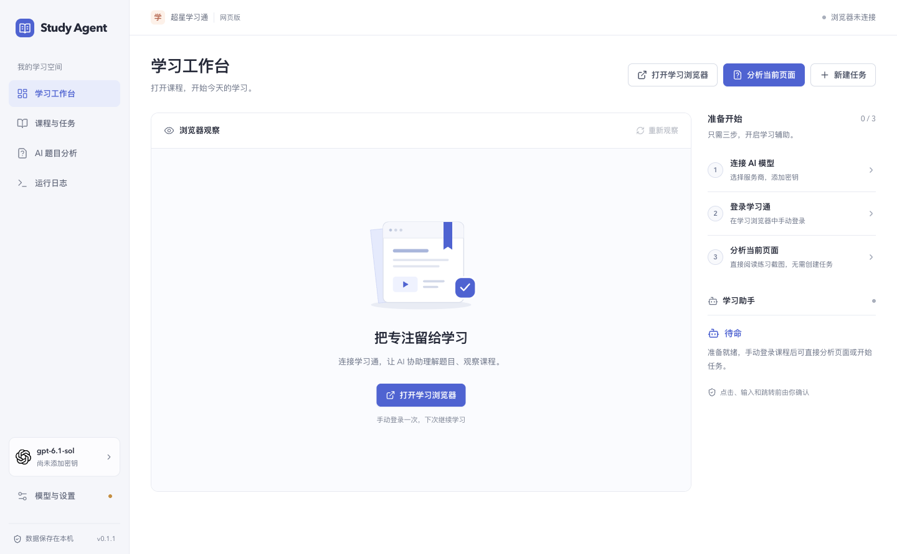
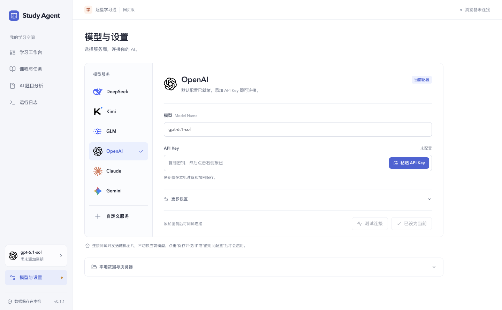

# 大学坝 | 学大坝

让 AI 看懂学习页面，陪你把课程学明白。

Study Agent 是一款桌面学习助手，目前面向超星学习通网页版。课程任务、视频进度和题目解析集中在一个工作台，浏览器里的操作由你掌控。

**[下载 macOS 安装包（M 系列）](https://github.com/Yosyoo/Study-Agent/releases/download/v0.1.1/Study.Agent-0.1.1-arm64.dmg)** · [全部版本](https://github.com/Yosyoo/Study-Agent/releases) · [反馈问题](https://github.com/Yosyoo/Study-Agent/issues)

## 下载与安装

| 平台 | 下载 |
| --- | --- |
| macOS · Apple Silicon（M 系列） | [下载 v0.1.1 · DMG](https://github.com/Yosyoo/Study-Agent/releases/download/v0.1.1/Study.Agent-0.1.1-arm64.dmg) |
| macOS · Intel | 安装包待提供 |
| Windows 10 / 11 | 安装包待提供 |

打开 DMG，将 **Study Agent** 拖入「应用程序」即可。安装包约 324 MB，已包含学习浏览器，无需安装开发工具。

当前为早期体验版，macOS 安装包尚未签名和公证，系统可能提示无法验证开发者。使用时需要自己的模型 API Key，调用费用由所选服务商收取。

## 用它做什么

- **管理学习任务** — 保存课程地址与学习目标，随时开始、暂停、恢复或接管。
- **看清当前页面** — 查看浏览器截图和助手的观察结果，确认后执行页面操作。
- **跟踪视频进度** — 查看真实播放位置、总时长和播放状态，发现暂停、卡顿或异常。
- **一键分析当前页** — 无需创建任务，AI 直接阅读题目截图，给出单选、多选、判断、填空题的答案建议与解析，供你核对。
- **自由选择模型** — 内置 DeepSeek、Kimi、GLM、OpenAI、Claude、Gemini 配置，也支持自定义服务地址和模型。

## 开始使用

1. **连接模型**：进入「模型与设置」，选择服务商，粘贴 API Key，测试连接后点击「保存并使用」或「使用此配置」。
2. **登录课程**：打开学习浏览器，手动登录学习通，进入需要学习的课程。
3. **分析练习**：进入题目页面，点击「分析当前页面」，对照截图核对答案建议和解析；页面没截全时，手动滚动后可重新分析。
4. **管理课程**：需要持续观察视频或辅助导航时，再新建学习任务。随时暂停、恢复或接管；暂停和人工核对不消耗实际运行时限。

## 数据与使用说明

API Key 保存在本机，由系统加密保护；系统加密不可用时仅在当前会话使用。登录会话保存在本机，失效后需重新登录。使用 AI 分析时，当前页面截图与必要的页面信息会发送给你选择的模型服务商。

题目解析用于辅助理解，不自动填写或提交答案。视频按平台正常方式播放，不伪造观看时长或绕过验证。学习通页面与模型回答都可能变化，当前版本仍需真实课程验收，关键操作和答案请自行核对。

## 开发与贡献

欢迎通过 [Issues](https://github.com/Yosyoo/Study-Agent/issues) 反馈问题或建议。反馈时请附应用版本、系统和复现步骤，并隐去账号、密钥及个人信息。

[开发与构建](docs/DEVELOPMENT.md) · [架构说明](docs/ARCHITECTURE.md) · [模型配置](docs/MODEL_PRESETS.md) · [验证记录](docs/VALIDATION.md)

基于 Electron、React、TypeScript 和 Playwright 构建。采用 [MIT 许可证](LICENSE)；厂商图标来自 [Lobe Icons](https://github.com/lobehub/lobe-icons)。
