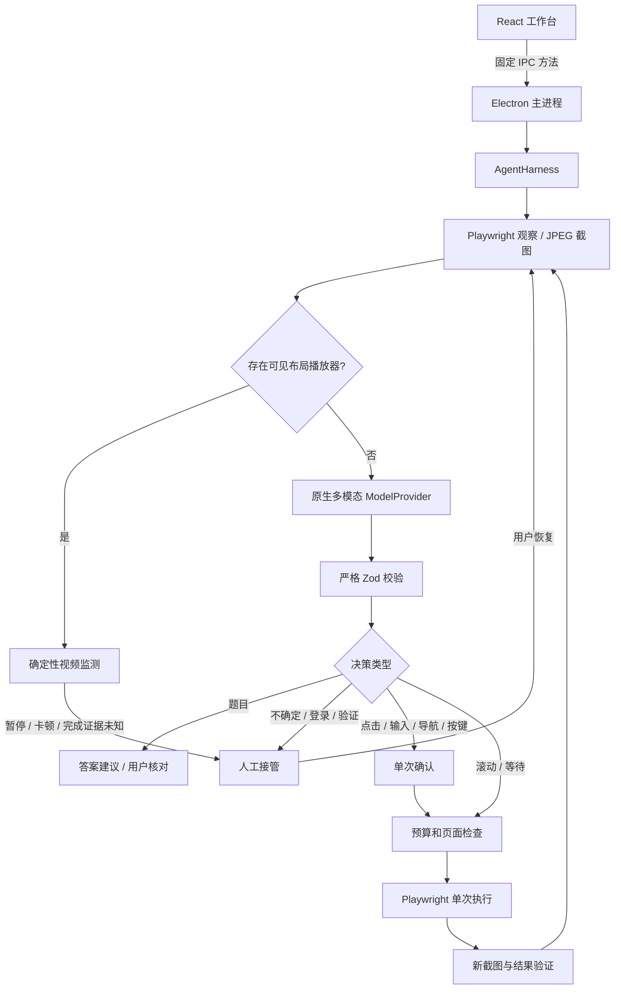

# 架构与执行边界

## 决策方式

采用轻量混合模式：确定性状态机处理登录拦截、播放器监测、预算、确认和恢复；只有不可确定的页面视觉理解与下一步决策调用模型。没有长计划执行队列，模型每轮最多提出一个动作，减少页面变化后继续执行旧计划的风险。

`start()` 安排后台串行驱动并立即返回，使 IPC 保持响应。每次暂停、停止和恢复都会改变 generation；模型及工具返回后必须检查 generation，失效结果不能启动新操作。模型 HTTP 和等待支持 AbortSignal；浏览器在队列、页面检查后、动作派发前检查信号。已经派发的单次输入或点击无法撤回，界面不承诺撤销。

## 进程与职责

- **renderer**：展示 `AppState`，发送固定方法请求。不连接模型，不拥有密钥，不接触 Playwright。
- **preload**：只暴露 `StudyAPI`；不暴露 `ipcRenderer.send/invoke` 的任意通道调用，也不把 IPC Event 传给页面。
- **main/index**：验证 IPC sender、主 frame 与本地 renderer URL；校验输入；组装服务；协调手动操作与 Agent；维护任务及日志。
- **BrowserController**：串行浏览器操作、合法平台边界、持久会话、iframe、截图、内部布局指纹、视频原始采样、敏感操作拒绝。
- **ModelProvider**：构造多模态请求、总超时、有限重试、响应大小限制、结构校验。模型结果只是数据。
- **AgentHarness**：执行循环、最小上下文、预算、确认状态、结果验证、人工接管。可用 fake port 测试，不依赖 Electron。
- **StateStore / SecretStore**：有序原子 JSON 与 OS 加密密钥。重启不会自动恢复执行中的动作。

`BrowserPort`、`ModelProvider` 是实际需要的两条依赖边界。适配新的模型协议可实现 `ModelProvider`；适配新的学习平台优先在浏览器页面识别和 URL 策略处增加有证据的规则，不需要增加插件框架或新服务器。

## 模型输入与上下文

模型收到：用户目标、当前 CSS 视口截图、URL 的 origin/path（省略查询和片段）、标题、页面类型提示、有限播放器与完成证据，以及最近 8 条最多 1000 字的执行摘要。不会发送题目 DOM 文本、完整页面 HTML、cookies、localStorage 或 API Key。截图本身可能包含个人信息，因此用户设置页明确告知数据流向。

题目由图像识别，避免把混淆字体对应的 DOM 字符当作题意。DOM 仅用于导航结构提示、控件保护、内部指纹和播放器采样。可见问题超出当前视口时，模型只能请求滚动/等待或人工调整；不能捏造遮挡内容。

每次响应要求完整的 `ModelDecision`，包含 `summary/confidence/pageType/questions/action/needsHuman/done`。未知字段、未知动作、越界坐标、不合法 JSON 被拒绝；工具执行前再次校验，避免替换 provider 后绕过边界。题目建议无论置信度高低都进入核对；核对只完成本次分析，不自动答题。

## 观察与动作有效性

视口固定为 1280×800 CSS 像素，截图使用 `scale: 'css'`。模型坐标范围 0–1000，按实际 viewport 映射至 Playwright CSS 坐标，边缘会被夹到有效像素。点击前逐层检查真实命中的 iframe 元素，并处理边框和 CSS 缩放。

执行动作依赖最近 observation ID 和默认 30 秒时效。URL、滚动、焦点、控件几何、标签、链接、选中状态等内部哈希必须一致；截图前后也检查稳定性。布局指纹不把题目文本提供给模型。它降低常见位移风险，但不是浏览器的事务锁：任意页面 JavaScript 仍可能在最后一次检查和实际点击之间变化，用户应核对操作且不要同时操纵页面。

结果验证记录新的截图和是否发生可观察变化。页面变化只证明工具产生了可观察结果，不证明平台接受了提交、课程完成或答案正确。平台完成状态另有保守证据字段。连续无变化或重复建议会转为接管。

## 视频与平台完成状态

每个有正常可见布局的 `<video>` 读取 `currentTime/duration/paused/ended/readyState/networkState/playbackRate/buffered/error`，遍历所有相关 iframe。隐藏、零尺寸播放器及隐藏 iframe 被过滤，视口外但具有正常布局的视频仍可监测。动态/不支持的播放器无法读取时不冒充成功。

视频状态与平台状态分离：播放结束不是任务点完成。只有与当前视频 frame 对应的任务容器存在明确完成标记才认定平台完成，多容器存在未知时保持未知。现有 `.ans-attach-ct`、`.ans-job-finished` 与标题规则是可审查的启发式，不是平台官方 API，尚需真实学习通页面校准。

暂停和异常请求用户处理，不自动播放、快进、倍速、刷新视频以伪造观看。原生 video、滑块及常见进度/倍速控件不接受模型点击，提交/支付/验证同样由用户手动完成。

## Prompt Injection 与安全边界

系统 Prompt 明确网页像素、标题、URL 和执行观察是不可信数据，网页中的“系统指令”不改变权限。真正的权限边界在程序中：平台域名校验、固定动作联合类型、无代码执行工具、无凭据工具、输入与来源校验、单次人工确认、预算、敏感控件拒绝。

这不能保证模型永远不被误导。模型可能误读、产生错误建议，网页可能使用新控件或脚本竞态。人工确认是有意保留的产品能力。第一版没有宣称通用网页恶意行为检测，也不允许无人值守提交答案。
